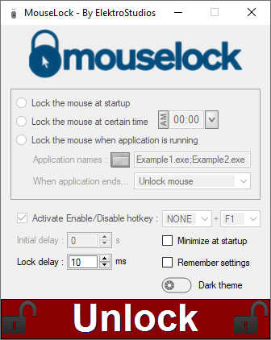
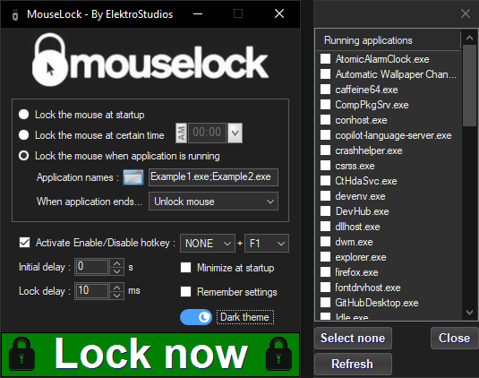

<!-- Common Project Tags:
desktop-app 
desktop-application 
dotnet 
dotnet-core 
netcore 
netframework 
netframework48 
tool 
tools 
vbnet 
visualstudio 
windows 
windows-app 
windows-application 
windows-applications 
windows-forms 
winforms 
 -->

  
  
  <h1>MouseLock (GUI)</h1>

### Locks the mouse pointer at the center of the screen until a specified key is pressed.

------------------

    &nbsp;
    &nbsp;
    &nbsp;
    
    &nbsp;
    
   
   
    
    
    
    
    
    
   
    
    
    
    
    
    
   
   
    

------------------

## 👋 Introduction

This project is a simple Windows desktop utility that provides a straightforward graphical interface designed to restrict (lock) your mouse pointer to the center of the screen, releasing it only when a custom shortcut is pressed.

This is an older project preserved mainly for practical use and historical reference. While the underlying source code does not reflect modern development architectures or refactoring habits, the tool remains fully functional and lightweight.

## 💡 Motivation

Many older video games and classic PC titles do not natively handle multi-monitor setups or modern display boundaries correctly. When playing in windowed or borderless modes, moving your mouse too far to the edge often causes the cursor to drift onto a second monitor. If you accidentally click outside the game window, it instantly minimizes or loses focus during gameplay. 

I built this humble utility to solve this exact irritation, giving gamers an automated way to clamp the cursor safely in place when specific processes are running, without needing heavy third-party software.

##### ⚡ The Real Question
###### Why let cursor drifting ruin your classic gaming sessions or force-minimize your windowed games when you can lock your mouse to the screen center automatically?.

## 🖼️ Screenshots

    
    
  

## 🤖 Features

 - Automatically locks the mouse when MouseLock program runs.
 - Automatically locks the mouse at certain hour.
 - Automatically locks the mouse when a specified process is running.
 - Set a single key or combination key to unlock the mouse.
 - Set a initial delay to start locking the mouse.

## 📝 Requirements

- Microsoft Windows OS.

## 🚀 Getting Started

1. Navigate to the **[Releases page](https://github.com/ElektroStudios/MouseLock-GUI-A-mouse-locker/releases/latest)**.
2. Download the latest `.zip` archive or the `.exe` setup installer, depending on your preference.
3. If you downloaded the `.zip` archive, extract its contents to your preferred directory.
     
   If you downloaded the `.exe` file, run it and follow the installation wizard.
4. Run the executable file to launch the application.

## 🔄 Change Log

Explore the complete list of changes, bug fixes, and improvements across different releases by clicking [here](/Docs/CHANGELOG.md).

## 💪 Contributing

Your contribution is highly appreciated!. If you have any ideas, suggestions, or encounter issues, feel free to open an issue by clicking [here](https://github.com/ElektroStudios/MouseLock-GUI-A-mouse-locker/issues/new/choose). 

Your input helps make this Work better for everyone. Thank you for your support! 🚀

## 💰 Beyond Contribution

This work is distributed for educational purposes and without any profit motive. However, if you find value in my efforts and wish to support and motivate my ongoing work, you may consider contributing financially through the following options:

| Platform | How to Support |
| :---: | :--- |
|  | **[Become my sponsor on GitHub](https://github.com/sponsors/ElektroStudios/)** Contribute any amount you prefer and unlock rewards! |
|  | **[Support me on Ko-fi](https://ko-fi.com/elektrostudios)** Buy me a coffee! |
|  | **[Become a Patron on Patreon](https://www.patreon.com/c/elektrostudios/membership)** Support my open-source work regularly! |
|  | **[Make a PayPal Donation](https://www.paypal.com/cgi-bin/webscr?cmd=_s-xclick&hosted_button_id=E4RQEV6YF5NZY)** Donate any amount you like via PayPal! |
|  | **[Purchase my software at Envato's CodeCanyon](https://codecanyon.net/item/elektrokit-class-library-for-net/19260282)** Discover my desktop tools and **DevCase Class Library for .NET**, an extensive API suite. |

 

  <b>Your support means the world to me! Thank you for considering it! 🤗💗</b>

------------------

## 🏆 Credits

This work relies on the following technologies and libraries: 

 - [.NET Framework](https://dotnet.microsoft.com/en-us/download/dotnet-framework)
 - [CButtonLib](https://www.codeproject.com/Articles/26622/Custom-Button-Control-with-Gradient-Colors-and-Ext)
 - [gTimePicker](https://www.codeproject.com/Articles/39204/gTimePicker-Control-to-Pick-a-Time-Value-VB-NET)

## ⚠️ Disclaimer

This software and its associated repository are provided strictly on an "as is" basis, without warranties of any kind, whether express or implied. This includes, but is not limited to, any implied warranties of merchantability, reliability, or fitness for a particular purpose.

The authors and copyright holders assume no liability for any direct, indirect, incidental, or consequential damages—including data loss or system errors—arising from the use, misuse, or inability to use this software. You are solely responsible for determining the appropriateness of using this tool and assume all associated risks.

Furthermore, this project operates entirely independently. The utilization of any third-party libraries or components within this software does not imply any affiliation with, or endorsement or approval by, their respective original authors.

This project is licensed under the **Apache License, Version 2.0**. See the  [License](./LICENSE) file for details.
